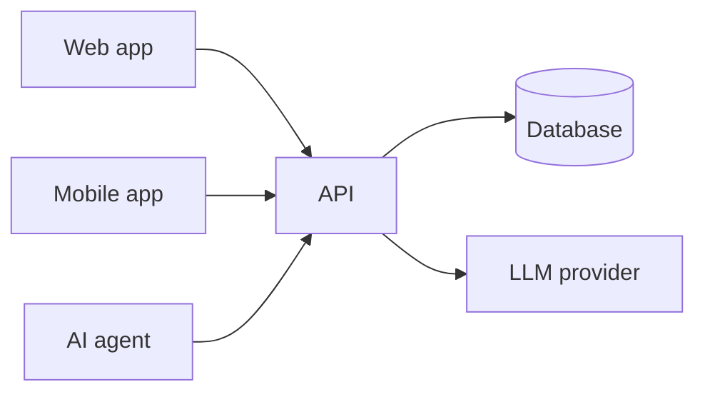

# Project name

> One-sentence description of what your system does and for whom.

## Authors

| Name | GitHub | Main responsibilities |
|------|--------|-----------------------|
| TODO-AUTHOR | @… | … |
| TODO-AUTHOR | @… | … |

<!-- Lab repository: one row. Project repository: both team members. -->

## Live system

| Part | URL |
|------|-----|
| Web app | … |
| API (+ docs) | … |
| Health check | … |
| Mobile app | build instructions below / APK in Releases |

## Architecture

See [docs/architecture.md](docs/architecture.md).



## Stack

| Part | Technology |
|------|------------|
| Backend | … |
| Web front end | … |
| Database | … |
| Mobile | … |
| Cloud | … |
| LLM provider | … |

Reasons: see [docs/decisions/](docs/decisions/).

## Running locally

### Prerequisites
- …

### Configuration (secrets)
Describe which environment variables / user secrets are needed and how to set them.
**Never commit real secrets.**

### Start
```bash
# e.g. docker compose up
```

### Tests
```bash
# e.g. dotnet test / npm test / pytest
```

### Mobile app
How to build and run it, and how to point it to a local or production API.

## Documentation

| Document | Content |
|----------|---------|
| [docs/proposal.md](docs/proposal.md) | Problem, users, user stories |
| [docs/data-model.md](docs/data-model.md) | ER diagram |
| [docs/architecture.md](docs/architecture.md) | Components and deployment |
| [docs/api/openapi.yaml](docs/api/openapi.yaml) | REST API contract |
| [docs/agent.md](docs/agent.md) | Agent tools and guardrails |
| [docs/decisions/](docs/decisions/) | Architecture decision records |
| [docs/ai-usage-log.md](docs/ai-usage-log.md) | How we used AI tools |
