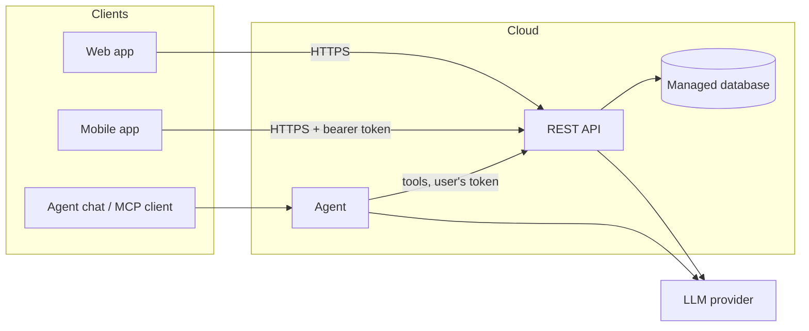
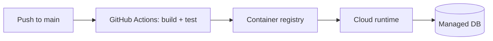

# Architecture

## Components

Update this diagram as the system evolves.

## Layers (backend)
<!-- Presentation → business logic → data access. Name the main projects/modules. -->

## Authentication & authorization
<!-- How users log in, which token/cookie, which roles, where checks happen. -->

## Deployment
<!-- Cloud services used, how CI/CD deploys, where secrets live, where logs are. -->

