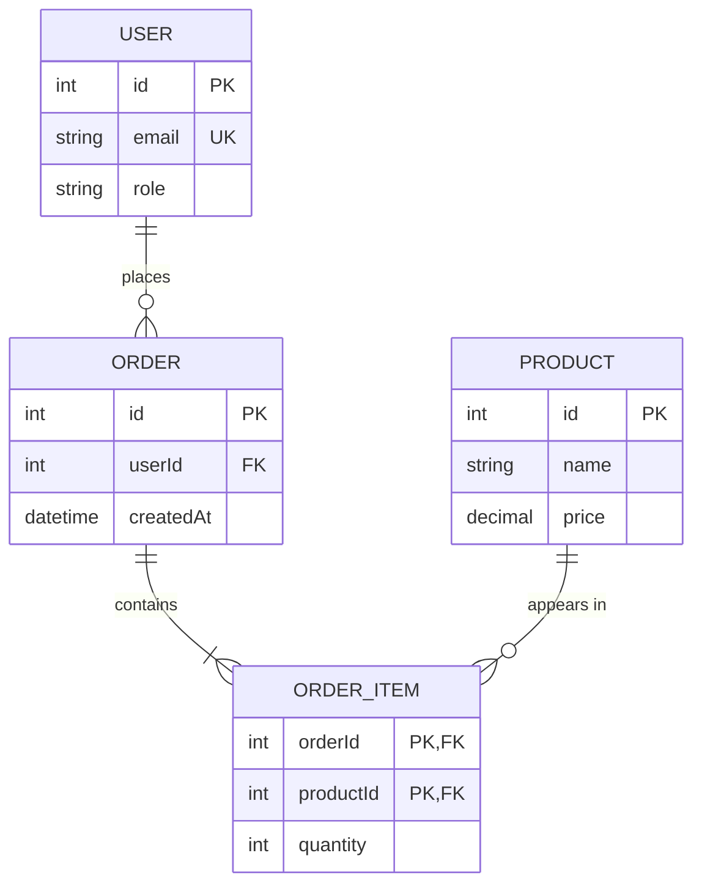

# Data Model

Replace the example with your own model. Requirements: at least 3 entities, one 1:N and one M:N relationship.

## Entities

| Entity | Description | Important rules / constraints |
|--------|-------------|-------------------------------|
| | | |

## Business rules
<!-- e.g. "A room cannot have two bookings that overlap in time." -->
